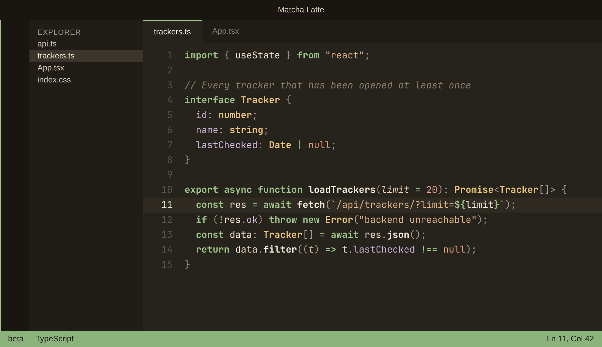
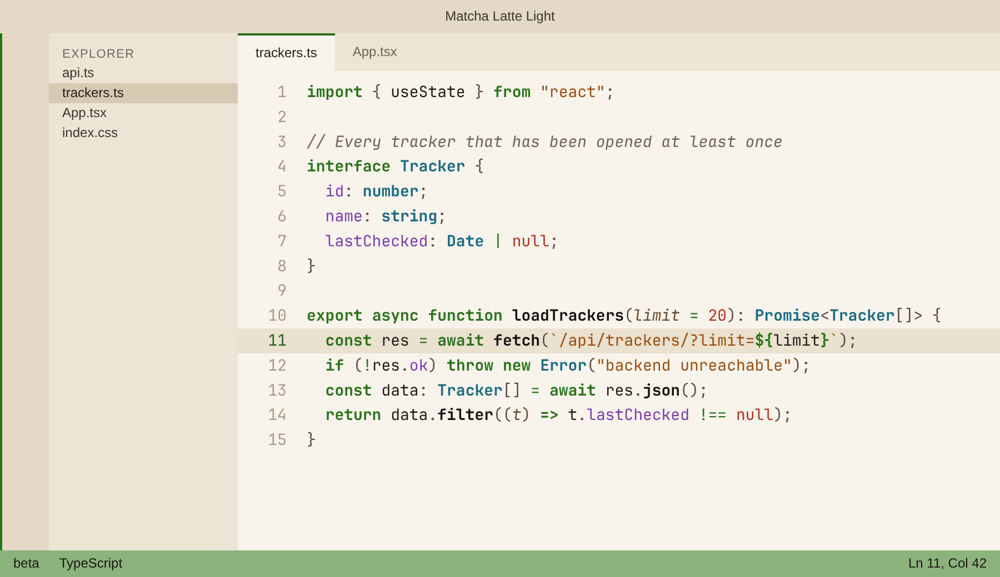
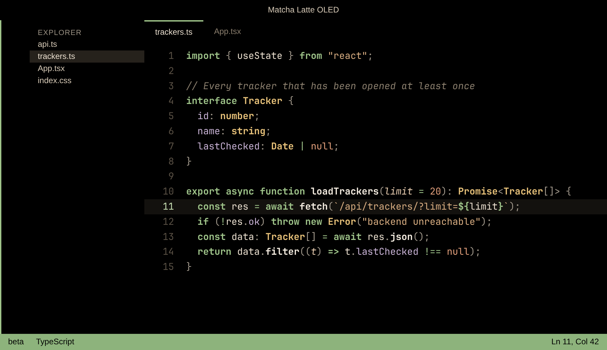

# Matcha Latte

A cozy VS Code theme inspired by a matcha boba latte. Pastel matcha green and latte brown, in three roasts.

Keywords, function names and types are **bold**, so the shape of the code reads at a glance. Every syntax colour clears 4.5:1 contrast against its background.

## Matcha Latte

Neutral roasted-brown background, cream text.



## Matcha Latte Light

Milk-foam cream background. On cream, the colours spread further apart in hue — types turn teal-blue — so they stay easy to tell apart.



## Matcha Latte OLED

True black backgrounds, so the pixels switch off on OLED screens. Same syntax colours as the dark roast.



## Install

Search for **Matcha Latte** in the Extensions view, then pick a variant with **Preferences: Color Theme** (`Ctrl+K Ctrl+T`).

## Palette

| Role | Dark / OLED | Light |
|------|-------------|-------|
| Keywords | `#9FC48A` matcha, bold | `#2B721B`, bold |
| Strings | `#D9AE82` latte | `#9A4F10` |
| Types | `#E8C27A` honey, bold | `#1A6A82`, bold |
| Functions | `#F5EDE1` cream, bold | `#15120E`, bold |
| Numbers & constants | `#E3A07C` brown sugar | `#B0341C` |
| Properties | `#C9B3D6` taro | `#7A3DA8` |
| Comments | `#8B7F6E` italic | `#6E6355` italic |

## Contributing

`themes/matcha-latte-color-theme.json` is the source. The Light and OLED files are generated from it — edit the dark theme, then run:

```bash
python3 build.py
```

To change a colour in only one variant, edit that variant's map at the top of `build.py`. `scripts/screenshots.py` regenerates the preview images (needs Google Chrome).

## License

[MIT](LICENSE)
